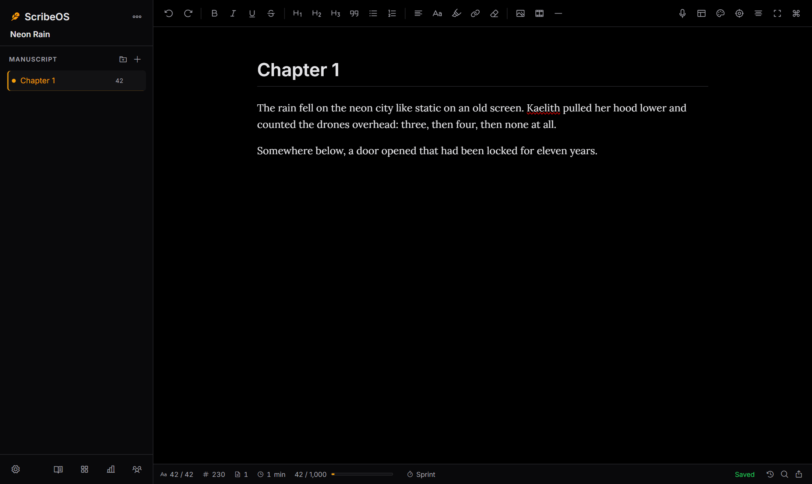

# ScribeOS 🖋️

A calm, offline-first writing studio for novels, scripts and manga. ScribeOS 2 is a **desktop app**: your projects are plain folders you save anywhere, and one toggle opens a **Teamwork** session so friends can write with you live from their browser.

Crafted with focus in mind by BocchiTheTrader.



## ✨ Features

| | |
|---|---|
| **Projects you own** | Each project is a `.scribe` folder (chapters, notes, codex, images) saved wherever you choose. Save As, single-file archives (`.scribez`) and a recent-projects list. |
| **Never lose a keystroke** | Atomic autosave, a crash-recovery journal, automatic chapter snapshots with a side-by-side diff, rotating zip backups to a folder you choose, and a chapter trash with undo. |
| **Editor** | Headings, lists, quotes, colours, highlights, links, alignment, scene breaks, smart typography, typewriter / focus / zen modes, and vertical text for manga. |
| **Images, GIFs & media** | Paste, drag-and-drop or insert images, animated GIFs, video and audio. No 2 MB limit: files are streamed to disk and the size limit is a setting (default 200 MB). Resize, align, caption and add alt text. |
| **Fonts** | 11 fonts built in and available offline (Lora, EB Garamond, Literata, Courier Prime, OpenDyslexic, Bangers, Noto Sans JP…), plus your installed system fonts or your own .ttf/.otf/.woff2 files. |
| **Themes** | Dark (OLED), Light, **Book** (sepia paper, drop caps), **Manga** (screentone, ink panels, comic headings), a custom theme with a contrast check, or follow the system. Switch with `Ctrl+Shift+T`. |
| **Export** | Vector **PDF** with paperback 6×9, manuscript, A4, A5 and manga-script layouts and a live preview. Also **Word (.docx)**, **EPUB**, **Markdown** (with images), **HTML**, **TXT** and a full project archive. |
| **Import** | DOCX, Markdown, HTML and TXT (split into chapters automatically), plus ScribeOS 1.x JSON backups. |
| **Voice-to-text** | Offline dictation with Whisper. Audio is processed on your computer and never uploaded. 99 languages and spoken commands ("new paragraph", "comma", "scene break", "stop dictation"). |
| **Teamwork** | Starts a server on your local network and shows an invite link, QR code, room code and password. Guests only need a browser. Live editing with named cursors and chat; guests are Editors, Commenters or Viewers. Kick guests, lock the room or change the password at any time. |
| **Planning** | Parts and chapters with drag-and-drop, status and colour labels, synopses, a corkboard, a Codex (characters / places / items with underlined mentions), 13 story templates and sticky notes. |
| **Motivation** | A daily goal across all projects, streaks, a 12-month heatmap, a project word target with deadline, writing sprints and read-aloud. |
| **Fast & clean** | The `Ctrl+K` command palette reaches every action, and settings are organised in tabs. |

## 🚀 Getting started

Windows 10/11 is the tested platform. macOS and Linux should work from source but haven't been tested yet.

### Run from source
Requires **Python 3.11+** (3.13 tested). The built interface is included, so Node.js isn't needed to run the app.

```powershell
git clone https://github.com/BocchiTheTrader/ScribeOS.git
cd ScribeOS
py -3.13 -m venv .venv
.venv\Scripts\activate
pip install -e .
pip install -e ".[voice]"   # optional: offline dictation (~150 MB of libraries)
python -m scribeos          # opens the desktop window
```

Useful flags:
- `--browser` opens the app in your web browser instead of a window.
- `--data-dir PATH` keeps settings in a folder of your choice (portable mode).
- `--self-test report.json` runs diagnostics.
- `--debug` prints detailed logs.

### Build a Windows `.exe`
```powershell
pip install -e ".[dev,voice]"
python -m PyInstaller packaging/scribeos.spec --noconfirm --distpath build/dist --workpath build/work
```
Double-click `build\dist\ScribeOS\ScribeOS.exe`. Keep the whole `ScribeOS` folder together, because the exe needs the `_internal` folder beside it. To make an installer, compile `packaging\installer.iss` with [Inno Setup](https://jrsoftware.org/isinfo.php).

To launch it from the project folder (or your desktop), create a shortcut to the exe:
```powershell
$exe = "$PWD\build\dist\ScribeOS\ScribeOS.exe"
$lnk = (New-Object -ComObject WScript.Shell).CreateShortcut("$PWD\ScribeOS.lnk")
$lnk.TargetPath = $exe; $lnk.WorkingDirectory = Split-Path $exe; $lnk.IconLocation = "$exe,0"; $lnk.Save()
```
Shortcuts hold absolute paths, so `*.lnk` files are git-ignored. Each machine makes its own.

The exe isn't code-signed yet, so Windows may show "Windows protected your PC". Click **More info**, then **Run anyway**. When the packaged app runs without a console, its log is written to `%LOCALAPPDATA%\ScribeOS\Logs\scribeos.log`.

### Teamwork tips
- The first time you start Teamwork, Windows may ask whether ScribeOS may accept connections. Allow **Private networks** only.
- Guests must be on the same network. To write with someone over the internet, use a VPN such as [Tailscale](https://tailscale.com).

### Moving from ScribeOS 1.x
In the old version, click the download button to save a **JSON backup**. In ScribeOS 2, choose **Import ScribeOS 1.x backup…** on the welcome screen. Projects, chapters, embedded images, notes and settings are converted. The 1.x browser version remains in this repository's commit history.

## 🧑‍💻 Development

```powershell
pip install -e ".[dev,voice]"
cd web; npm ci; npm run build; cd ..          # rebuild the interface into scribeos/web_dist

python -m pytest tests --ignore=tests/e2e     # unit, API, security and collaboration tests
python -m pytest tests/e2e                    # browser tests (uses installed Microsoft Edge)
python -m ruff check scribeos
python -m bandit -q -r scribeos -c pyproject.toml
python -m pip_audit; cd web; npm audit; cd ..
```

| Folder | What lives there |
|---|---|
| `scribeos/` | The Python app: `app.py` (window + server), `server/` (API, security, websockets), `storage/` (project format, sanitiser, backups), `export/`, `collab/` (Teamwork), `voice/` |
| `web/` | Interface source (Vite + TipTap 3 + Yjs). It builds into `scribeos/web_dist/` |
| `tests/` | pytest suites. `tests/e2e/` drives a real browser with Playwright |
| `packaging/` | PyInstaller spec, frozen-app launcher, Windows installer script and icon |

## 🗺️ Roadmap
Planned next:
- Inline comments and a suggestion (track-changes) mode
- Split view, outliner and timeline
- Offline grammar checking (LanguageTool)
- Remappable shortcuts and multiple custom themes
- An optional AI writing assistant
- Interface translations
- Code signing, auto-update and tested macOS/Linux builds

## 🔒 Security
- **Private by default.** The app's server listens on `127.0.0.1` only. The desktop window signs in with a random token created at each launch. The owner session is accepted only from your own computer, and Host headers are checked to block DNS rebinding.
- **Teamwork is opt-in.** Guests need a room code and a password, which is hashed with Argon2. Login attempts are rate-limited. Sessions live on the server and can be revoked; changing the password or ending the session signs every guest out. Roles are enforced on the server for every request and every live edit.
- **Content safety.** Every document is sanitised on the server against a strict schema (no scripts, no `javascript:` links, no external images). Pages use a strict Content-Security-Policy, and every request that changes data must carry a CSRF token. Uploads are type-checked by their content, not their filename, and are served sandboxed.
- No API keys or accounts are needed. Voice recognition runs locally; its speech model is downloaded once from Hugging Face the first time you use dictation.

Found a security problem? Please [open an issue](https://github.com/BocchiTheTrader/ScribeOS/issues) without exploit details, and you'll be contacted for the specifics.
